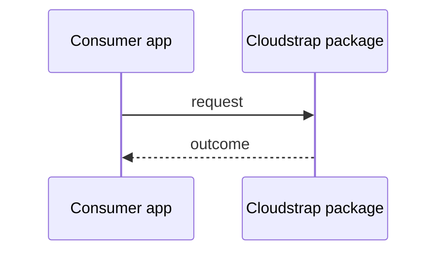

# Spec: <Feature Name>

<!--
Lives in _specs/<FeatureName>/spec.md. The workflow is in .claude/rules/spec-driven.md.
`investigate` fills Status, Goal, Findings and Open questions; `write-spec` fills the rest.
Outside the Scaffold: no file lists, class or test names, line numbers or code — except a contract
that is itself the requirement (a route, a DTO shape, a message name, a `Cloudstrap:` config key).
Remove the sections the feature does not need; What happens, Slices and Scaffold always stay.
-->

## Status

- <date>: branch `<branch>` from `<base>`.
- <date>: investigation done. Spec not written.

## Goal

<Who it is for and what they can do afterwards, in one or two sentences.>

## Findings

<!-- What exists today, what the request depends on, the risk areas touched, the options that fit the code.
Each finding says how it is known (the file read, the command run). For an extraction deliverable: the
source material read and, per public type or feature, its verdict Port / Redesign / Replace / Drop with the
reason (docs/extraction-backlog.md § Porting rules). -->

1. <finding> — <how it is known>

## Open questions

<!-- Ordered: the questions that change the size or shape of the work first. The spec is not ready for
approval while one remains that changes behavior. -->

- [ ] <question>

## Behavior

<!-- In the detail the feature needs: the public entry points (`AddCloudstrap<Feature>` / `UseCloudstrap<Feature>`),
the `Cloudstrap:<Feature>` options with their defaults and the override of every opinionated default, rules with
their messages, endpoints (route, auth, errors), pages, background work and messages, edge cases, culture and
encoding wherever output is formatted. -->

### Rules

| # | Rule | Error or message |
|---|------|------------------|
| BR-1 | ... | "..." |

### Edge cases

| Case | Expected behavior |
|------|-------------------|
| ... | ... |

## What happens

<!-- Mermaid, at component level (consumer app, Cloudstrap package, external service), never at file or class
level. Labels contain no `;`, `#` or unbalanced quotes. -->

## Acceptance criteria

<!-- Numbered, stable once approved; each names a check that would fail if the behavior were broken
(a test at a stated level, an API call and its response, a page action and its result). -->

| # | Given | When | Then | Check |
|---|-------|------|------|-------|
| AC-1 | ... | ... | ... | <integration test: scenario and expected outcome> |

## Constraints

<!-- Risk areas from CLAUDE.md § Project settings that the feature touches, marked ⚠️; new dependencies with
their licence; Aspire composability where the feature overlaps ServiceDefaults (AC-ASP1–AC-ASP3). -->

- ⚠️ <risk area> — <why>

## Out of scope

- <item>

## Slices

<!-- One row per slice, named by what the user or the system can do afterwards; ⚠️ on those in a risk area.
The outer test is an integration test (CLAUDE.md § Project settings § Test levels). State: todo / built / accepted. -->

| # | Slice | AC | Outer test | Human check | State |
|---|-------|----|-----------|-------------|-------|
| 1 | <what can be done afterwards> | AC-1 | <scenario → expected outcome> | <steps, or "none: reason"> | todo |

## Scaffold

<!-- Per slice: the files to create, modify or delete, one line each saying what changes and why, plus one line
for DI registrations and wiring. Checked in the code; no steps, no code. -->

### Slice 1

| File | Change | Why |
|------|--------|-----|
| `src/...` | create / modify / delete | ... |
| DI registrations and wiring | ... | ... |
