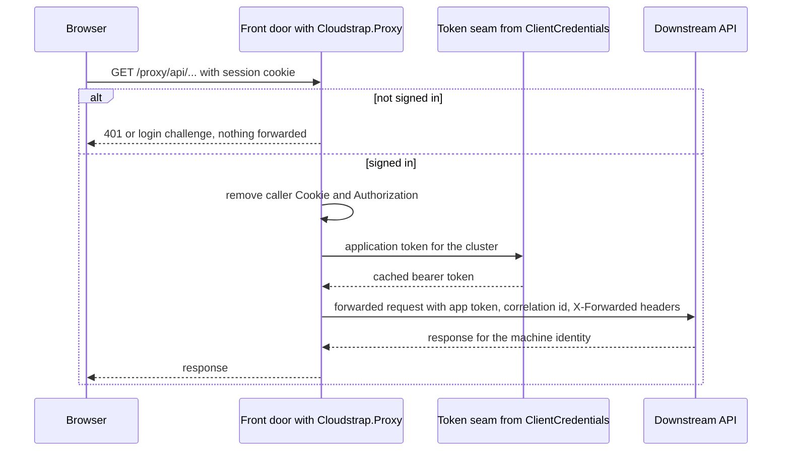

# Spec: Trusted-subsystem proxy — `Cloudstrap.Proxy` (extraction deliverable #17)

## Status

- 2026-11-28: branch `feature/trusted-subsystem-proxy` from `zyggy/01M8GNMRJ5214Q0BYF6QRMD7WD` @ `89233e3` (the spec-driven kit branch with `origin/dev` merged in; `dev` itself does not carry the kit yet).
- 2026-11-28: **carried over** from the retired process. Source: the approved spec `_specs/17-TrustedSubsystemProxy.md` (approved by the owner 2026-11-22, source-checked, Decision Log D-1…D-15, Port Decision Table) and its build record `_plans/17-TrustedSubsystemProxy.md` (Steps 1–9 done, Gates 1–3 approved, Gate 4 open). Both stay as history; this file is the spec from now on. The acceptance criteria keep their approved ids.
- 2026-11-28: Slices 1–2 accepted (old Gates 2 and 3); Slice 3 built, awaiting the owner's acceptance (old Gate 4); Slice 4 todo. Q-1…Q-3 answered by the owner the same day.
- 2026-11-28: spec written. No `spec-critic` pass (not asked for).
- 2026-11-28: **approved by the owner.** Next: the Q-3 mutation check, then the owner's acceptance of Slice 3, then Slice 4 on the owner's go.
- 2026-11-28: the Q-3 mutation check ran: 95.9 % (`mutation-1-3.md`, committed in `96da9d0`).
- 2026-11-28: job `01M8GT8NGG37JJVR8HERQZDG2J` (unattended; its instructions stood for the owner's go): the branch was re-based on `dev` @ `96da9d0`, which now carries the kit; Slice 4 built; the retired build record `_plans/17-TrustedSubsystemProxy.md` removed, its open items moved to `docs/extraction-backlog.md` §17; then the final review. Slices 3 and 4 await the owner's acceptance; the final review report is the material for the owner's last gate.

## Goal

A developer building a front-door host (BFF, interactive web app) forwards selected routes to a downstream API with one registration call: the front door signs the user in, the downstream API receives the application's own access token, the caller's cookie and bearer token never leave the front door, and an anonymous caller can never ride on the application's token.

## Findings

Carried from the approved spec (its Port Decision Table holds the source facts with file and line) and checked against the code on 2026-11-28.

1. **Slices 1–3 are built and green.** `Cloudstrap.Proxy` (YARP 2.3.0, MIT, CPM-pinned) with `Cloudstrap.Proxy.Tests` 115/115 on the merged tree; build with zero code warnings (only the known NU1902/NU1903 advisories) — `dotnet build` and the test executable, run 2026-11-28 on `89233e3`.
2. **No mutation evidence exists for Slices 1–3.** They were built before the kit's mutation check was adopted; `scripts/mutation-check.mjs` accepts `--base` and `--files`, so it can be run on the built package (Q-3).
3. **The demo topology is in place.** The Bff (5300) signs the user in with the OIDC cookie (the cookie is the default scheme; bearer callers are forwarded to the JWT scheme by `BearerCoexistence`), owns the `demo-bff` machine client (`Cloudstrap:ClientCredentials`) and already calls the Api (5330) with the user's token (`UserApi`). The Api is a pure JWT host, authenticated by default, with `GET api/v1/downstream/whoami` echoing `sub`, `client_id`, `scope` and the marker `demo-api` — `src/demo/BlazorWasm/Bff/Program.cs`, `appsettings.json`, `src/demo/Api/Controllers/DownstreamController.cs`.
4. **The `demo-bff` machine token is not valid at the Api.** Its audiences are `demo-selfapi` only, "deliberately Bff-only" per the seed comment; the Api requires `demo-api`. The test IdP stamps every audience of a client into every token and has no `resource` parameter, so the per-cluster `TokenRequestParameters` cannot select it. No test depends on the Api rejecting a `demo-bff` token — `TestIdentityProviderSeed.cs`, the test IdP's `EndpointRouteBuilderExtensions.cs` (`SetAudiences`), grep over `src` for `demo-bff`. The retired plan's Step 10 ("no per-cluster parameters needed") missed this (Q-1).
5. **The demo apps have no host-level integration test project.** Their behavior is proven only by `Cloudstrap.Demo.E2E.Tests`; the kit wants every slice's outer test to be an integration test (Q-2).

## Open questions

All answered by the owner 2026-11-28, each with the recommended option.

- [x] **Q-1 — demo machine token audience.** **Decided**: add `demo-api` to the `demo-bff` client's audiences in the demo IdP seed (demo data only; the comment is updated). Rejected: proxy in `User` mode (contradicts D-7); a second machine identity in the Bff (out of scope, one identity per host).
- [x] **Q-2 — outer test of the demo slice.** **Decided**: Slice 4's outer test is the E2E test, a recorded exception to § Test levels, because the demo apps have no host-level harness and every package behavior it shows already has its integration test in Slices 1–3. Rejected: a new host-level test harness for the Bff.
- [x] **Q-3 — mutation evidence for Slices 1–3.** **Decided**: run `node scripts/mutation-check.mjs --slice 1-3 --base 01d4102 --files <the src/Cloudstrap.Proxy/*.cs files>` once before Slice 3 is accepted, evidence in `_specs/17-TrustedSubsystemProxy/mutation-1-3.md`; if the score is below the threshold (80), the missing tests are added in the same pass (tests only, no production change without an amendment).

## Behavior

The full behavior, public API and conventions are those of the approved spec (§ Public API Sketch, § Behaviors & Conventions, § Deliberate Behavior Changes, § Edge Cases, all unchanged), as built:

- `builder.AddCloudstrapProxy(configure?)` → YARP's `IReverseProxyBuilder`; `endpoints.MapCloudstrapProxy()` → `ReverseProxyConventionBuilder`.
- Options `Cloudstrap:Proxy`: `ConfigurationSection` (default `ReverseProxy`), `DefaultTokenMode` (default `Client`), `StripInboundCredentials` (default `true`); validated on start.
- Metadata keys: `Cloudstrap.TokenMode` (cluster), `Cloudstrap.ForwardInboundCredentials` and `Cloudstrap.AllowAnonymousWithToken` (route). Token request parameters per cluster: `Cloudstrap:Proxy:Clusters:{clusterId}:TokenRequestParameters`.

### Rules

| # | Rule | Error or message |
|---|------|------------------|
| BR-1 | A proxied route without an `AuthorizationPolicy` requires a signed-in user (`Default`); nothing is forwarded otherwise | the front door's challenge (401 / login redirect) |
| BR-2 | The caller's `Cookie` and `Authorization` are removed before forwarding, unless the global option or the route's unsafe opt-out says otherwise | — |
| BR-3 | A `Client` / `User` cluster without its token provider fails start (or the reload that adds it) and is never forwarded without a token | names the cluster, the metadata key and the package to install |
| BR-4 | An `Anonymous` route on a `Client` / `User` cluster fails start unless the route sets `Cloudstrap.AllowAnonymousWithToken: true` | names the route, the cluster and the override key |
| BR-5 | An unknown or numeric token mode fails start | lists the allowed values |
| BR-6 | The demo Bff forwards `/proxy/api/{**catch-all}` (prefix removed) to the Api in `Client` mode | — |

### Edge cases

As the approved spec § Edge Cases, all covered by Slices 1–3 (token failure → 502 without forwarding; downstream 401 passed through; hot reload; WebSocket/SSE README note).

## What happens

## Acceptance criteria

Ids and wording as approved (the approved spec § Acceptance Criteria holds the full Given/When/Then); the Check column names the proof.

| # | Criterion (short) | Check |
|---|-------------------|-------|
| AC-PX1 | One call over YARP's `ReverseProxy` config forwards a route; YARP's builders returned | integration: `RegistrationTests` |
| AC-PX2 | No policy → signed-in user required, nothing forwarded otherwise | integration: `AuthorizationDefaultTests` |
| AC-PX3 | Caller `Cookie` / `Authorization` never reach the destination; per-route unsafe opt-out | integration: `InboundCredentialTests` |
| AC-PX4 | `Client` cluster carries the app token from the seam; no provider → fails loudly | integration: `ClientTokenModeTests` |
| AC-PX5 | `Anonymous` route on a token cluster refused at start; explicit override | integration: `ConfusedDeputyGuardTests` |
| AC-PX6 | `User` / `None` modes; unknown mode fails start | integration: `TokenModeTests` |
| AC-PX7 | Correlation header and `traceparent` continue on the proxied hop | integration: `ObservabilityCompositionTests` |
| AC-PX8 | `X-Forwarded-*` kept, spoofed prefix replaced, destination `Host` | integration: `ForwardedHeaderTests` |
| AC-PX9 | No resilience handler, no second exporter | integration: `ObservabilityCompositionTests` |
| AC-PX10 | `Cloudstrap:Proxy` options validated on start | integration: `RegistrationTests`, `TokenModeTests` |
| AC-PX11 | Packaging, XML docs, sealed surface, README, CPM pin + licence | unit: `PackageSurfaceTests`, `DependencyPinTests` |
| AC-PX12 | Destinations from YARP's `IDestinationResolver` keep every Cloudstrap behavior; no Aspire/ServiceDiscovery reference | integration: `DestinationResolverCompositionTests` |
| AC-PX13 | Zero `Nihdi`/`NIHDI`/`Riziv`/`Wfe`/`Cfe` in the deliverable's files | unit: `RepositoryHygieneTests` + final-review grep |
| AC-ASP2 / AC-A3 | Zero `Aspire.*` / `Nihdi.AspNetCore.*` in the closure | unit: `RepositoryHygieneTests` |
| AC-PX14 | The demo Bff proxies `/proxy/api/**` to the Api in `Client` mode: (a) a signed-in browser's proxied `whoami` reports `clientId` `demo-bff`, host `demo-api`, and not the user's subject; (b) an anonymous call is stopped at the Bff (401 or IdP challenge, no `demo-api` marker); (c) the Api sees no `Cookie` and a `Bearer` `Authorization` | E2E: the trusted-subsystem proxy tests in `Cloudstrap.Demo.E2E.Tests`, one per (a)–(c) |

## Constraints

- ⚠️ Auth / credential handling — the proxy decides which credential leaves the process (Slices 1–2, accepted at old Gates 2–3; Slice 4 is live auth in the demo).
- ⚠️ Public API — the package surface, pinned by `PackageSurfaceTests` (accepted at old Gate 3).
- ⚠️ Dependency — `Yarp.ReverseProxy` 2.3.0, MIT (accepted at old Gate 1).
- ⚠️ Shared contract with #18 — path-prefixed route, `X-Forwarded-Prefix`, `Client` mode, authenticated by default.
- Aspire — composes through `IDestinationResolver`, never a reference (AC-ASP2).

## Out of scope

As the approved spec § Out of Scope: the Hangfire dashboard proxy (#18), token exchange, a Cloudstrap route schema, resilience/rate limiting/caching/body transforms, BFF session features, any Aspire or ServiceDiscovery reference, multiple application identities, a custom TLS validator (D-13), environment detection (D-11). Also: the #9 provider's warning text naming `Cloudstrap:HttpClients:{name}` for a cluster (recorded follow-up).

## Slices

| # | Slice | AC | Outer test | Human check | State |
|---|-------|----|-----------|-------------|-------|
| 1 ⚠️ | One registration call forwards a route, requires a signed-in user, and keeps the caller's credentials at the front door | AC-PX1, AC-PX2, AC-PX3, AC-PX8, AC-PX10 (section) | `RegistrationTests`, `AuthorizationDefaultTests`, `InboundCredentialTests`, `ForwardedHeaderTests` | old Gates 1–2 | accepted |
| 2 ⚠️ | The downstream API receives the application's token per cluster, and an anonymous route can never carry it | AC-PX4, AC-PX5, AC-PX6, AC-PX10 (token mode) | `ClientTokenModeTests`, `TokenModeTests`, `ConfusedDeputyGuardTests` | old Gate 3 | accepted |
| 3 | The proxied hop composes with Cloudstrap observability and YARP destination resolution, and the package is complete | AC-PX7, AC-PX9, AC-PX11, AC-PX12, AC-PX13, AC-ASP2, AC-A3 | `ObservabilityCompositionTests`, `DestinationResolverCompositionTests` | review the handler chain order, the package surface and `src/Cloudstrap.Proxy/README.md`; the mutation evidence `mutation-1-3.md` (Q-3) | built |
| 4 ⚠️ | A signed-in user of the demo Bff reaches the Api through `/proxy/api/**` as the Bff's machine identity, an anonymous caller is stopped at the Bff, and the Bff cookie never reaches the Api | AC-PX14 | E2E (Q-2 exception): signed-in → proxied `whoami` = `demo-bff` / `demo-api`; anonymous → 401 at the Bff; proxied `inbound` → no cookie, `Bearer` | run IdP, Api and Bff (`src/demo/README.md`), sign in at http://127.0.0.1:5300/, open `/proxy/api/api/v1/downstream/whoami` → `clientId` `demo-bff`; sign out and open it again → 401 | built |

After Slice 4: the final review (feature gate, code analysis, `spec-reviewer`, and `security-review` once over the whole diff because Slices 1, 2 and 4 are ⚠️).

## Scaffold

### Slices 1–3 (built — record of what exists)

| File | Change | Why |
|------|--------|-----|
| `src/Directory.Packages.props` | modified | `Yarp.ReverseProxy` 2.3.0 pin (MIT) |
| `src/Cloudstrap.sln` | modified | the package and its test project |
| `src/Cloudstrap.Proxy/Cloudstrap.Proxy.csproj`, `README.md` | created | package (→ `Cloudstrap.Extensions` + YARP only) and its trusted-subsystem README |
| `src/Cloudstrap.Proxy/HostApplicationBuilderExtensions.cs`, `EndpointRouteBuilderExtensions.cs` | created | `AddCloudstrapProxy` / `MapCloudstrapProxy` |
| `src/Cloudstrap.Proxy/CloudstrapProxyOptions.cs`, `CloudstrapProxyOptionsValidator.cs`, `ProxyClusterTokenOptions.cs` | created | `Cloudstrap:Proxy` options, start validation, per-cluster token parameters |
| `src/Cloudstrap.Proxy/ProxyTokenMode.cs`, `ProxyMetadataKeys.cs`, `ProxyMetadataReader.cs` | created | token modes and metadata keys |
| `src/Cloudstrap.Proxy/ProxyRouteConfigFilter.cs` | created | authenticated-by-default and the confused-deputy guard |
| `src/Cloudstrap.Proxy/CloudstrapForwarderHttpClientFactory.cs` | created | handler chain: correlation → token handler → YARP's handler |
| `src/Test/UnitTest/Cloudstrap.Proxy.Tests/**` | created | the integration and unit tests named in Acceptance criteria, with `Infrastructure/` (front door, echo server, fake token seams, resolver) |
| DI registrations and wiring | built | `AddCloudstrapProxy` binds YARP from the section, adds the config filter, the credential-stripping transforms, replaces `IForwarderHttpClientFactory`, validates options on start |

### Slice 4

| File | Change | Why |
|------|--------|-----|
| `src/demo/BlazorWasm/Bff/Cloudstrap.Demo.BlazorWasm.Bff.csproj` | modify | `ProjectReference` to `Cloudstrap.Proxy` |
| `src/demo/BlazorWasm/Bff/Program.cs` | modify | `builder.AddCloudstrapProxy()` and `endpoints.MapCloudstrapProxy()`, with a comment on the trusted-subsystem hop |
| `src/demo/BlazorWasm/Bff/appsettings.json` | modify | `ReverseProxy` section: route `/proxy/api/{**catch-all}` with `PathRemovePrefix: /proxy/api` → cluster `demo-api`, destination `http://127.0.0.1:5330/`, metadata `Cloudstrap.TokenMode: Client` |
| `src/demo/Shared/IdentityProvider/TestIdentityProviderSeed.cs` | modify (Q-1) | `demo-bff` audiences gain `demo-api`; comment updated |
| `src/demo/Api/Controllers/DownstreamController.cs` | modify | `GET api/v1/downstream/inbound`: whether a `Cookie` arrived and the `Authorization` scheme — observes AC-PX14 (c) |
| `src/demo/Shared/Contracts/DownstreamInboundDto.cs` | create | `DownstreamInboundDto(bool CookiePresent, string? AuthorizationScheme, string Host)` |
| `src/demo/README.md` | modify | Bff feature row "trusted-subsystem proxy (#17)"; the `/proxy/api` hop in the architecture notes |
| `src/Test/E2E/Cloudstrap.Demo.E2E.Tests/TrustedSubsystemProxyTests.cs` | create | AC-PX14 (a)–(c) through the running Bff and Api (sign-in through `BrowserSignIn`) |
| DI registrations and wiring | modify | `AddCloudstrapProxy` after `AddCloudstrapClientCredentials` (the `Client` seam provider); `MapCloudstrapProxy` inside `UseCloudstrapWebApi`'s `ConfigureEndpoints`, before `MapFallbackToFile`, so authentication and authorization run first and the SPA fallback does not swallow `/proxy/api` |
