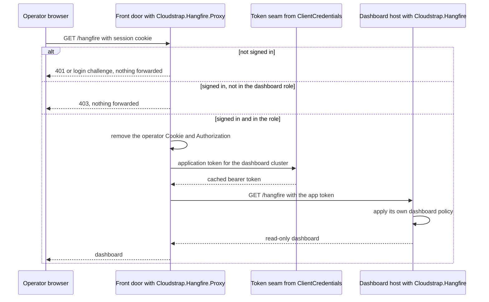

# Spec: Hangfire dashboard proxy — `Cloudstrap.Hangfire.Proxy` (extraction deliverable #18)

## Status

- 2026-11-28: branch `feature/hangfire-dashboard-proxy` from `origin/dev` @ `96da9d0`.
- 2026-11-28: investigation done (job `01M8GT8NGG37JJVR8HERQZDG2J`, unattended: no interview was held, so every open question carries a recommendation).
- 2026-11-28: spec written as a **Draft** on the recommended answers. Not approved: Q-1…Q-7 wait for the owner. Critic run, one pass (verdict "not ready, 6 blocking"; report in `artifacts/`, not committed). Blocking findings 2–6 and the configuration-section gap are worked in below; finding 1 (open questions) stands until the owner answers.
- Depends on #17's demo slice (the Bff's proxy, the `demo-bff` audience at the Api), which is on `feature/trusted-subsystem-proxy`, not yet on `dev`: merge #17 first, then rebase this branch before Slice 1.

## Goal

An operator signed in at a front-door host (BFF, interactive web app) opens the Hangfire dashboard of a separate dashboard host (a JWT API or worker sharing the Hangfire storage) at the front door's own URL, after one registration call on the front door: only a signed-in user in the dashboard role gets through, the dashboard host sees the front door's own application token and never the operator's cookie or token, and the links the dashboard renders stay on the front door.

## Findings

Sources read: `docs/extraction-backlog.md` §18; `_specs/16-HangfireScheduler.md` (finding 12, Part C, DD-1, AC-HF10, AC-HF13); `_specs/17-TrustedSubsystemProxy.md` (source-check facts, D-14, D-15) and `_specs/17-TrustedSubsystemProxy/spec.md`; the code of `src/Cloudstrap.Hangfire/` (`EndpointRouteBuilderExtensions.cs`, `HangfireDashboardOptions.cs`, `DashboardOptionsComposer.cs`, `AuthenticatedDashboardAuthorizationFilter.cs`, `README.md`), `src/Cloudstrap.Proxy/` (`README.md`, `HostApplicationBuilderExtensions.cs`), `src/Cloudstrap.WebApi/WebApplicationExtensions.cs`, the demo hosts `src/demo/BlazorWasm/Bff/Program.cs`, `src/demo/Api/Program.cs`, `src/demo/BlazorServer/Program.cs`, `src/demo/Shared/IdentityProvider/TestIdentityProviderSeed.cs`, and the E2E `HangfireTests.cs`. Two throwaway probes were compiled and run against the pinned packages (not committed): **P1** — a web host with `UseForwardedHeaders` and `ForwardedHeaders.XForwardedPrefix`, called with `X-Forwarded-Prefix: /ops`, answered `PathBase=/ops|Path=/hangfire`; **P2** — reflection over Hangfire 1.8.25's `DashboardOptions` lists, among others, `PrefixPath`, `IgnoreAntiforgeryToken`, `IsReadOnlyFunc`, `AsyncAuthorization`.

1. **The source package was not opened in this job.** The job was confined to this repository, so `Nihdi.Core.Configuration.Hangfire.Proxy\` in the read-only reference repo was not read. What is known about it comes from the source checks recorded in the repo: `HangfireDashboardProxyBinding` + `HangfireDashboardProxyExtensions` (`AddHangfireDashboardProxyForNihdiWfe` / `UseHangfireDashboardProxyForNihdiWfe`): a trusted-subsystem proxy, a front-door role policy and a `/hangfire` forwarder; an empty role means any signed-in user; it used two internals of the old Hangfire package (`HangfireDashboardAccessEvaluator`, `ForwardedPrefixPathBase.DashboardPath`); its tests cover "policy registered, role denied, empty role allowed, null key" — `_specs/16-HangfireScheduler.md` Part C and finding 12, `_specs/17-TrustedSubsystemProxy.md` source-check block and D-15 (Q-7).
2. **Port decisions** (per source feature, on the facts of finding 1):

   | Source feature | Verdict | Target | Why |
   |---|---|---|---|
   | Front-door role policy (`HangfireDashboardAccessEvaluator`: authenticated, and in the role when one is set) | **Replace** | stock `RequireAuthenticatedUser().RequireRole(role)` as the proxied route's policy | #16 replaced the same evaluator this way; YARP routes take a named policy. |
   | `/hangfire` forwarder with the client-credentials token (`…ForNihdiWfe`) | **Redesign** | one route + one cluster on the #17 proxy, `Cloudstrap.TokenMode: Client`, at the dashboard path | #17 owns forwarding, credential stripping, token attachment and the confused-deputy guard; #18 adds only what is specific to the dashboard. Host-type vocabulary (`Wfe`) is dropped. |
   | `ForwardedPrefixPathBase` (`X-Forwarded-Prefix` → `PathBase` on the dashboard host, strictly validated) | **Replace** (Q-3) | Hangfire's own `DashboardOptions.PrefixPath`, set from configuration on the dashboard host | P2: the option exists in 1.8.25; a static prefix trusts no header. P1: the stock middleware would also do it, but it trusts a header and needs a known-proxy list that container platforms rarely give. |
   | `InternalsVisibleTo` from the Hangfire package | **Drop** | public seam only | #16 DD-1: `Dashboard:Path` and `RequiredRole` are public. |
   | `Nihdi:`-keyed configuration reading | **Drop** | `Cloudstrap:Hangfire:Proxy` options, validated on start | #1 options pattern. |
3. **The front door needs no Hangfire.** The forwarder, the role policy and the path are front-door concerns; none calls Hangfire. A package referencing `Cloudstrap.Hangfire` would put the LGPL-3.0 `Hangfire.*` family into every front door's closure for nothing; `Cloudstrap.Proxy` alone is enough — `src/Cloudstrap.Hangfire/Cloudstrap.Hangfire.csproj`, its README (LGPL notice), `src/Cloudstrap.Proxy/Cloudstrap.Proxy.csproj`.
4. **The dashboard-host half already ships.** `MapCloudstrapHangfireDashboard()` on a JWT host admits any authenticated caller when `Dashboard:RequiredRole` is unset — "the posture for a proxy host calling with a token" (`src/Cloudstrap.Hangfire/README.md` § Dashboard). `Dashboard:AuthorizationPolicy` can name a stricter consumer policy, for example one requiring the front door's `client_id`; nothing builds such a policy today (Q-4).
5. **#17 gives the shared contract, verified by its tests.** A route without a policy requires a signed-in user and a named policy is kept; `Cookie` and `Authorization` are removed; a `Client` cluster carries the application token; `X-Forwarded-Prefix` is set from the front door's `PathBase` (not from `PathRemovePrefix`) and a caller-sent one is replaced — `ForwardedHeaderTests`, `AuthorizationDefaultTests`, `InboundCredentialTests`, `ClientTokenModeTests` in `src/Test/UnitTest/Cloudstrap.Proxy.Tests/`. So when the front door forwards `/hangfire/**` to `/hangfire/**` and has no path base, the dashboard's links are already right; a prefix matters only under a front-door path base (`Cloudstrap:Application:PathBase`, applied by `UseCloudstrapWebApi`, `WebApplicationExtensions.cs:128`).
6. **#17 requires its configuration section to exist.** `AddCloudstrapProxy` loads YARP from the section named by `Cloudstrap:Proxy:ConfigurationSection` and fails start when it does not exist (`HostApplicationBuilderExtensions.cs`, `RegistrationTests.AddCloudstrapProxy_ConfigurationSectionMissing_…`). A front door whose only proxied route is the dashboard would therefore fail start if #18 added its route through a second, in-memory YARP provider. Writing the dashboard route and cluster as configuration keys under that section avoids it and keeps #17's loader, filter and validation unchanged; that `ConfigurationManager` sources added during registration are seen by #17's live section at start is **not verified** (Q-6).
7. **Dashboard actions may break behind the proxy.** The dashboard protects trigger, delete and requeue with the host's antiforgery tokens (`src/Cloudstrap.Hangfire/README.md` § Dashboard, `src/demo/BlazorServer/Program.cs:33-42`). The dashboard host's antiforgery cookie reaches the browser through the proxy, but #17 removes every `Cookie` on the way back, so the dashboard host would not see it. **Not verified** by running it, nor whether a pure JWT host such as `Cloudstrap.Demo.Api` registers antiforgery services at all (Q-2).
8. **The demo topology fits with one new dashboard host role.** The Bff (5300) signs the operator in (OIDC cookie; the seeded user has role `tester`), owns the `demo-bff` machine identity and, since #17, the proxy; `demo-bff` tokens are valid at the Api (5330, audience `demo-api`). A second machine client, `demo-machine`, also has audience `demo-api` — a ready "other application" for the Q-4 check. The Api is a pure JWT host on the `CloudstrapDemo` LocalDB database that the Worker's Hangfire storage uses; it does not run Hangfire today. The BlazorServer demo (5340) is #16's storage-only dashboard host but signs users in with a cookie, so it cannot accept the Bff's token — `src/demo/*/Program.cs`, `appsettings.json`, `TestIdentityProviderSeed.cs` (Q-5).
9. **Test levels.** `Cloudstrap.Hangfire.Tests` runs the dashboard on SQL Server LocalDB through `Cloudstrap.TestInfrastructure`; `Cloudstrap.Proxy.Tests` runs a TestServer front door against an in-process Kestrel echo. #18's integration test needs both, a front door with the package and a real dashboard host on LocalDB storage, in a new `Cloudstrap.Hangfire.Proxy.Tests` project.
10. **Risk areas touched**: auth (the front-door policy decides who reaches an operations UI; the token is the application's), public API (a new package and a new `Cloudstrap.Hangfire` option), the shared contract with #17 (unchanged on the recommended answers). No new third-party dependency.

## Open questions

Unattended job: none was put to the owner. Each has the recommended answer first; the Draft below is written on it. The spec is not ready for approval until Q-1…Q-6 are answered.

- [ ] **Q-1 — a package, or a documented recipe?** (a) **Recommended**: a thin `Cloudstrap.Hangfire.Proxy` referencing `Cloudstrap.Proxy` only, adding in one call the dashboard route, its `Client` cluster and the role policy — the founding spec's package map names it, and it keeps path, role and token mode consistent in one place. (b) No package: a README recipe in `Cloudstrap.Hangfire` (a `ReverseProxy` route and one `AddAuthorization` policy, about fifteen lines) plus the demo — Replace beats Redesign at equal value; it would amend the founding spec's package map, which only the owner does.
- [ ] **Q-2 — dashboard actions through the proxy** (finding 7, ⚠️ security). (a) **Recommended for v1**: the proxied dashboard is read-only — the dashboard host reached through a proxy sets `Dashboard:ReadOnly: true`, and Slice 1 proves that reading works and that an action changes nothing; actions stay available on a dashboard host signed into directly. (b) Amend #17 with a per-route allow-list of cookies to forward (only the dashboard host's antiforgery cookie): full function, but it loosens a ⚠️ rule of an approved spec. (c) `IgnoreAntiforgeryToken` on the dashboard host, relying on the front door's `SameSite=Lax` session cookie: rejected, it removes a CSRF defense.
- [ ] **Q-3 — links under a front-door path base.** (a) **Recommended**: a new `Cloudstrap:Hangfire:Dashboard:PrefixPath` (default none) on the dashboard host sets Hangfire's `PrefixPath` — static, no header trusted. (b) Honour `X-Forwarded-Prefix` with the stock forwarded-headers middleware — needs a known-proxy list. (c) Port the source's validated `ForwardedPrefixPathBase` — most code for the same result. (d) Out of v1: front doors serve the dashboard at the same path without a path base (documented); Slice 3 disappears.
- [ ] **Q-4 — the dashboard host admits only the front door.** (a) **Recommended**: documented, not a package rule: the README shows a `Dashboard:AuthorizationPolicy` requiring the front door's `client_id`, and the demo Api uses it, proven by AC-HP8. (b) A new `Cloudstrap:Hangfire:Dashboard:AllowedClientIds` option with its own integration test (more surface).
- [ ] **Q-5 — demo topology.** (a) **Recommended**: the Bff proxies `/hangfire/**` to the Api, which becomes a storage-only dashboard host (`RunServer = false`) on the shared storage, read-only (Q-2), with the Q-4 policy for `demo-bff`. (b) A new dedicated dashboard host (a new port and fixture). The BlazorServer dashboard stays as #16 left it in both.
- [ ] **Q-6 — entry point and how the route reaches YARP** (finding 6). (a) **Recommended**: `builder.AddCloudstrapHangfireDashboardProxy(configure?)` on `IHostApplicationBuilder`, which writes the route and cluster as configuration keys under #17's section (so it exists), requires `AddCloudstrapProxy` (start fails naming it otherwise) and never calls it (#17's "called once" rule stays). (b) An extension of YARP's `IReverseProxyBuilder` adding a second, in-memory provider — needs #17's "section must exist" rule relaxed (an amendment of #17).
- [ ] **Q-7 — source check.** **Recommended**: one read-only job over the source package and its tests before approval (as #17 did), to confirm finding 1 and look for a behavior missing here. The Draft does not depend on it.

## Behavior

On the recommended answers (Q-1 a, Q-2 a, Q-3 a, Q-4 a, Q-5 a, Q-6 a).

- **Front door**: `builder.AddCloudstrapHangfireDashboardProxy(configure?)`, next to `builder.AddCloudstrapProxy()`, adds a route `Cloudstrap.HangfireDashboard` matching `{Path}` and `{Path}/{**catch-all}` with the authorization policy `Cloudstrap.HangfireDashboard`, a cluster `Cloudstrap.HangfireDashboard` with the one destination `Destination` and `Cloudstrap.TokenMode: Client`, and that policy: an authenticated user, in `RequiredRole` when it is set; `AuthorizationPolicy` names a consumer policy used in its place. `MapCloudstrapProxy()` maps the route; there is no other mapping call.
- **Options** `Cloudstrap:Hangfire:Proxy`: `Destination` (absolute URI of the dashboard host, required), `Path` (default `/hangfire`, rooted, no trailing `/`; must equal the dashboard host's `Cloudstrap:Hangfire:Dashboard:Path`), `RequiredRole` (default none: any signed-in user), `AuthorizationPolicy` (default none). Validated on start. Token request parameters for the dashboard cluster are #17's key, unchanged: `Cloudstrap:Proxy:Clusters:Cloudstrap.HangfireDashboard:TokenRequestParameters` (documented; no option here).
- **Dashboard host** (`Cloudstrap.Hangfire`, changed in Slice 3 only): `Cloudstrap:Hangfire:Dashboard:PrefixPath` (default none) sets Hangfire's `PrefixPath`. The README documents the proxied posture: `RunServer = false` unless it processes, no `RequiredRole` (the front door checks the role), `Dashboard:ReadOnly: true` (Q-2), an `AuthorizationPolicy` that admits only the front door's `client_id` (Q-4), and `PrefixPath` equal to the front door's path base when it has one.

### Rules

| # | Rule | Error or message |
|---|------|------------------|
| BR-1 | Only a signed-in user, in `RequiredRole` when it is set, reaches the dashboard through the front door; for anyone else nothing is forwarded | the front door's challenge (401 for a bearer-style caller, login redirect for a cookie front door); 403 for a signed-in user outside the role |
| BR-2 | The dashboard host receives the front door's application token, never the operator's `Cookie` or `Authorization` (#17's rules, unchanged and never loosened by this package) | — |
| BR-3 | A missing or relative `Destination`, or a `Path` that is not rooted or ends with `/`, fails start | names the key (`Cloudstrap:Hangfire:Proxy:Destination` or `…:Path`) and the expected form |
| BR-4 | `AddCloudstrapHangfireDashboardProxy` without `AddCloudstrapProxy` fails start; called twice, it fails at the second call | names the missing call, or the method |
| BR-5 | A consumer route or cluster with the reserved id `Cloudstrap.HangfireDashboard` fails start | names the id |
| BR-6 | A dashboard host reached through the proxy is read-only: an action posted through the front door changes no job in storage | Hangfire's read-only refusal (not 2xx) |
| BR-7 | With the dashboard host's `PrefixPath` equal to the front door's path base, the links, assets and polling URL the dashboard renders start with that path base and `Path`; without it they lack the path base | — |

### Edge cases

| Case | Expected behavior |
|------|-------------------|
| The dashboard host is down | 502 from the front door, nothing cached; the operator's credentials never leave |
| The token endpoint fails | 502 from the front door, nothing forwarded (#17 edge case) |
| `RequiredRole` set, the user lacks it | 403 at the front door, nothing forwarded |
| The dashboard polls its stats endpoint | forwarded like any dashboard request, the token attached per request |
| The front door's only proxied route is the dashboard | starts: the route is written into #17's section (finding 6) |

## What happens

## Acceptance criteria

Prefix `AC-HP`. AC-ASP2 and AC-A3 are carried from the founding spec.

| # | Given | When | Then | Check |
|---|-------|------|------|-------|
| AC-HP1 | A front door with `AddCloudstrapProxy()` + `AddCloudstrapHangfireDashboardProxy()`, its `ReverseProxy` section empty of routes, `Destination` pointing at a dashboard host on LocalDB storage | A signed-in user requests `/hangfire` | 200 with the dashboard host's dashboard HTML; the dashboard host saw `Bearer` with the front door's application token and no `Cookie` | integration: front door + real dashboard host; fails if the route, the cluster, the token mode or the section handling is missing |
| AC-HP2 | The same, `RequiredRole: ops` | An anonymous caller (bearer-style scheme), an anonymous caller (cookie scheme), a signed-in user without `ops`, a signed-in user with `ops` | 401; a login redirect; 403; 200 — and the dashboard host received requests only for the last caller, none for the other three | integration, data-driven over the four callers |
| AC-HP3 | A dashboard host with `Dashboard:ReadOnly: true` behind the front door, one recurring job in storage | A signed-in operator opens the recurring-jobs page, then posts the trigger action for that job through the front door | The page lists the job; the post gets a non-2xx answer and the storage's enqueued count for the job's queue is unchanged; the same post made directly on a non-read-only dashboard host does enqueue (count + 1), so the posting path is real | integration on LocalDB storage |
| AC-HP4 | `AuthorizationPolicy: custom` naming a consumer policy | A caller that passes it and one that fails it | The consumer policy decides; `RequiredRole` is ignored | integration |
| AC-HP5 | `Destination` missing or relative; `Path` `hangfire` or `/hangfire/`; a consumer route or cluster with id `Cloudstrap.HangfireDashboard`; no `AddCloudstrapProxy`; the call made twice | The front door starts (or the second call runs) | It fails naming the key, the id, the missing call or the method | integration (host start), data-driven |
| AC-HP6 | A front door under path base `/ops`; the dashboard host's `Dashboard:PrefixPath` set to `/ops`, then unset | The dashboard page is requested at `/ops/hangfire` | With the option, every rendered anchor `href`, `script`/`link` asset URL and the page's polling URL starts with `/ops/hangfire`; without it, none starts with `/ops` | integration: the dashboard-host half in `Cloudstrap.Hangfire.Tests`, the full path through the front door in `Cloudstrap.Hangfire.Proxy.Tests` |
| AC-HP7 | `Cloudstrap.Hangfire.Proxy` and every file of the deliverable | Closure, surface, docs and text are inspected | References `Cloudstrap.Proxy` only: no `Hangfire.*`, `Aspire.*` or `Nihdi.AspNetCore.*` package in its closure (AC-ASP2, AC-A3); public types sealed or static with XML docs; README with the front-door/dashboard-host split and the Q-2 and Q-4 guidance; MIT metadata; zero `Nihdi`/`NIHDI`/`Riziv`/`Wfe`/`Cfe` | unit: package surface, closure and hygiene tripwires, plus the final-review grep |
| AC-HP8 | The demo (Q-5): the Bff proxies `/hangfire/**` to the Api dashboard host | The E2E suite runs | A signed-in `tester` opens `/hangfire` on the Bff and sees the Worker's recurring job; an anonymous browser is challenged at the Bff; at the Api's `/hangfire` directly, no token → 401 and a `demo-machine` token (another application) → 403 | E2E in `Cloudstrap.Demo.E2E.Tests`, written in the final review |

## Constraints

- ⚠️ Auth — who reaches an operations UI, and with which credential (Slices 1–2).
- ⚠️ Public API — a new package (Slice 1) and a new `Cloudstrap.Hangfire` option, `Dashboard:PrefixPath` (Slice 3).
- ⚠️ Shared contract with #17 — consumed unchanged on the recommended answers; Q-2 (b) or Q-6 (b) would amend #17.
- No new third-party dependency (YARP and Hangfire are pinned already; the new package does not reference Hangfire).
- Aspire: nothing new; the dashboard cluster composes with YARP's destination resolver like any #17 cluster.

## Out of scope

- Dashboard actions through the proxy (Q-2 a; a later amendment if the owner wants them).
- Honouring `X-Forwarded-Prefix` from headers (Q-3 a) and a port of the source's validator.
- Several dashboards behind one front door; per-user identity at the dashboard host (it sees the application); a dashboard on the front door itself (that is #16's `MapCloudstrapHangfireDashboard`).
- Any change to #17's rules.

## Slices

| # | Slice | AC | Outer test | Human check | State |
|---|-------|----|-----------|-------------|-------|
| 1 ⚠️ | A signed-in operator in the dashboard role reads the dashboard host's dashboard through the front door with one call; everyone else is stopped at the front door; actions through it change nothing; shown in the demo | AC-HP1, AC-HP2, AC-HP3, AC-HP7 (AC-HP8's demo change; its E2E in the final review) | front door + read-only dashboard host on LocalDB: anonymous → 401 / login redirect, nothing forwarded; no role → 403; `ops` → 200 dashboard HTML with `Bearer` and no `Cookie` at the dashboard host; a trigger post through the front door leaves the enqueued count unchanged | run IdP, Worker, Api and Bff (`src/demo/README.md`); sign in at http://127.0.0.1:5300/ as `geobarteam`, open `/hangfire` → the Worker's job is listed, no trigger button; sign out, open it again → the IdP login page | todo |
| 2 ⚠️ | A front door that is misconfigured fails start with the key to fix, and a consumer policy replaces the built-in one | AC-HP4, AC-HP5 | front door host start with each misconfiguration → fails naming the key/id/call; `AuthorizationPolicy: custom` → the consumer policy admits and refuses | none: every case is a start failure or a policy outcome the integration test shows; the README's configuration table is read at the final review | todo |
| 3 | Under a front-door path base the dashboard's links stay on the front door | AC-HP6 | front door under `/ops` with the dashboard host's `PrefixPath: /ops` → every link, asset and polling URL starts with `/ops/hangfire`; without the option none starts with `/ops` | start the Bff with `--Cloudstrap:Application:PathBase=/ops` and the Api with `--Cloudstrap:Hangfire:Dashboard:PrefixPath=/ops`, open http://127.0.0.1:5300/ops/hangfire and follow a link | todo |

After Slice 3: the final review (feature gate, code analysis, `spec-reviewer`, and `security-review` once over the whole diff because Slices 1 and 2 are ⚠️), with the AC-HP8 E2E tests.

## Scaffold

Checked against the code on 2026-11-28 (`96da9d0`); files marked create do not exist yet.

### Slice 1

| File | Change | Why |
|------|--------|-----|
| `src/Cloudstrap.Hangfire.Proxy/Cloudstrap.Hangfire.Proxy.csproj` | create | shipped package; `ProjectReference` to `Cloudstrap.Proxy` only; MIT, icon, README, `InternalsVisibleTo` the test project |
| `src/Cloudstrap.Hangfire.Proxy/HostApplicationBuilderExtensions.cs` | create | `AddCloudstrapHangfireDashboardProxy(this IHostApplicationBuilder, Action<HangfireDashboardProxyOptions>?)`: options, route + cluster written as configuration keys under #17's section, the `Cloudstrap.HangfireDashboard` policy |
| `src/Cloudstrap.Hangfire.Proxy/HangfireDashboardProxyOptions.cs` | create | `Cloudstrap:Hangfire:Proxy` options (`Destination`, `Path`, `RequiredRole`, `AuthorizationPolicy`) |
| `src/Cloudstrap.Hangfire.Proxy/README.md` | create | front door vs dashboard host, configuration, #17's token-parameters key for the dashboard cluster, the read-only and `client_id` guidance (Q-2, Q-4), the LGPL note (the dashboard host carries Hangfire, the front door does not) |
| `src/Cloudstrap.sln` | modify | the package and its test project |
| `src/Test/UnitTest/Cloudstrap.Hangfire.Proxy.Tests/Cloudstrap.Hangfire.Proxy.Tests.csproj` | create | references the package, `Cloudstrap.Hangfire` (dashboard-host side) and `Cloudstrap.TestInfrastructure` (LocalDB) |
| `src/Test/UnitTest/Cloudstrap.Hangfire.Proxy.Tests/Infrastructure/*` | create | front door (TestServer, test schemes with roles: bearer-style and cookie), dashboard host (Kestrel loopback, a test scheme validating the fake application token, storage-only Hangfire on the test database), a fake client-token seam, a request recorder |
| `src/Test/UnitTest/Cloudstrap.Hangfire.Proxy.Tests/DashboardProxyTests.cs` | create | AC-HP1, AC-HP2, AC-HP3 |
| `src/Test/UnitTest/Cloudstrap.Hangfire.Proxy.Tests/PackageSurfaceTests.cs`, `RepositoryHygieneTests.cs` | create | AC-HP7 |
| `.claude/spec-driven.json` | modify | the new test executable in `verify.commands` |
| `CLAUDE.md` | modify | the new test project in § Pack values **Test projects** and the Project Structure tree |
| `src/demo/BlazorWasm/Bff/Cloudstrap.Demo.BlazorWasm.Bff.csproj`, `Program.cs`, `appsettings.json` | modify | reference the package; `builder.AddCloudstrapHangfireDashboardProxy()`; `Cloudstrap:Hangfire:Proxy` with `Destination` `http://127.0.0.1:5330/` and `RequiredRole` `tester` |
| `src/demo/Api/Cloudstrap.Demo.Api.csproj`, `Program.cs`, `appsettings.json` | modify | `AddCloudstrapHangfire(h => h.RunServer = false)`; `MapCloudstrapHangfireDashboard()` through `UseCloudstrapWebApi`'s `ConfigureEndpoints`; `Dashboard:ReadOnly: true`; `Dashboard:AuthorizationPolicy` naming a demo policy for `client_id` `demo-bff` (Q-4) |
| `src/demo/README.md`, `src/demo/Api/README.md`, `src/demo/BlazorWasm/README.md` | modify | the `/hangfire` hop and the feature rows |
| DI registrations and wiring | create | `AddCloudstrapHangfireDashboardProxy` registers the options with `ValidateOnStart`, an in-memory configuration source holding the route and cluster under #17's section, and the authorization policy; the Bff calls it after `AddCloudstrapProxy()` and `AddCloudstrapClientCredentials()`; the Api registers its demo policy with `AddAuthorization` |

### Slice 2

| File | Change | Why |
|------|--------|-----|
| `src/Cloudstrap.Hangfire.Proxy/HangfireDashboardProxyOptionsValidator.cs` | create | BR-3 (source-generated validator pattern of #1 plus the URI and path checks) |
| `src/Cloudstrap.Hangfire.Proxy/HostApplicationBuilderExtensions.cs` | modify | BR-4 (missing `AddCloudstrapProxy`, second call), BR-5 (reserved ids), the consumer `AuthorizationPolicy` in place of the built-in one |
| `src/Test/UnitTest/Cloudstrap.Hangfire.Proxy.Tests/MisconfigurationTests.cs` | create | AC-HP4, AC-HP5 |
| DI registrations and wiring | modify | the validator registered with the options |

### Slice 3

| File | Change | Why |
|------|--------|-----|
| `src/Cloudstrap.Hangfire/HangfireDashboardOptions.cs` | modify | `PrefixPath` option (default none) |
| `src/Cloudstrap.Hangfire/DashboardOptionsComposer.cs` | modify | apply `PrefixPath` to Hangfire's `DashboardOptions` |
| `src/Cloudstrap.Hangfire/EndpointRouteBuilderExtensions.cs` | modify | pass `PrefixPath` to the composer |
| `src/Cloudstrap.Hangfire/README.md` | modify | "Behind a proxy": `ReadOnly`, `PrefixPath`, the `client_id` policy; replaces the "planned" note |
| `src/Test/UnitTest/Cloudstrap.Hangfire.Tests/DashboardOptionsTests.cs` | modify | `PrefixPath` set and unset (AC-HP6, dashboard-host half) |
| `src/Test/UnitTest/Cloudstrap.Hangfire.Tests/PackageSurfaceTests.cs` | modify | the new public option |
| `src/Test/UnitTest/Cloudstrap.Hangfire.Proxy.Tests/PrefixPathTests.cs` | create | AC-HP6 through the front door |
| DI registrations and wiring | modify | none new; `MapCloudstrapHangfireDashboard` passes the option through |
